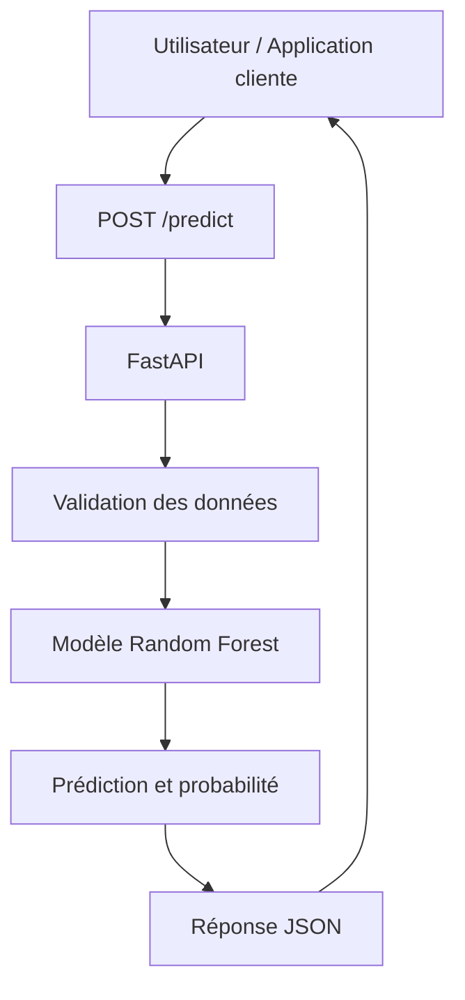
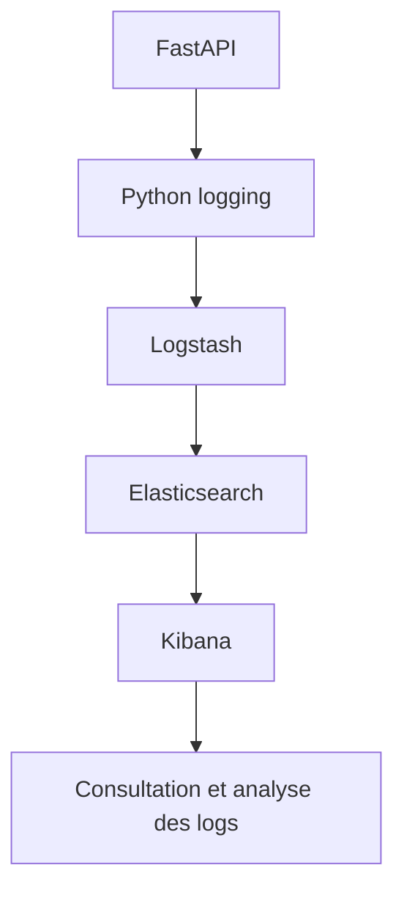
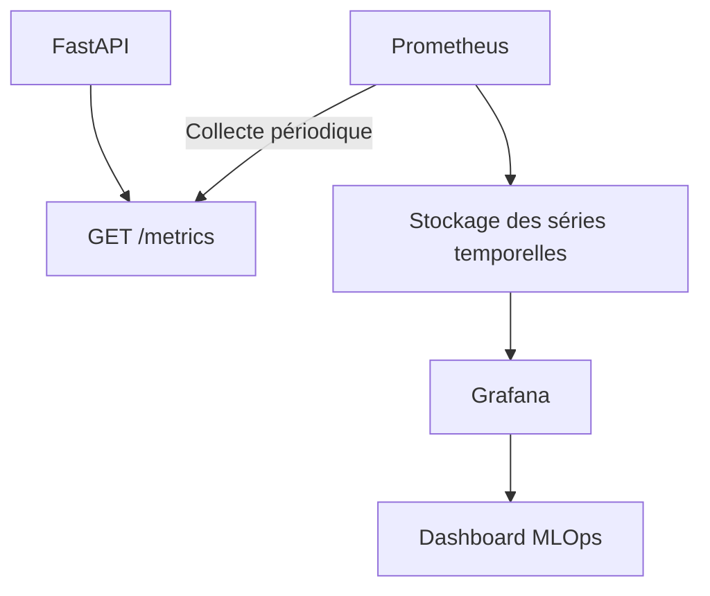
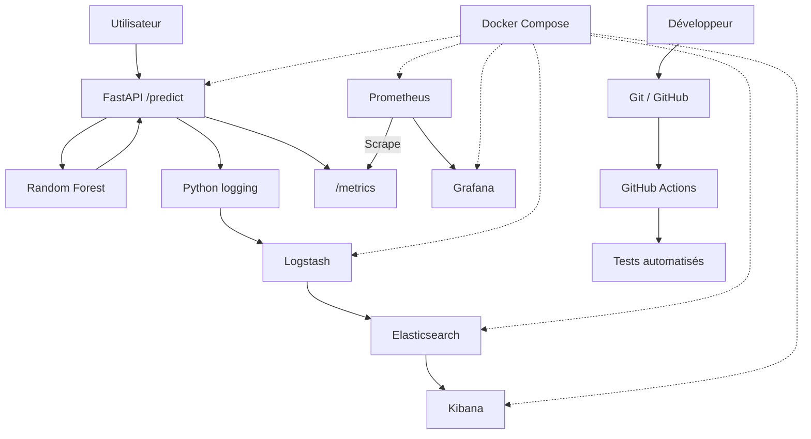

# Architecture du système MLOps — ML Churn Prediction

## 1. Présentation générale

Le projet **ML Churn Prediction** vise à prédire le risque de départ d'un client d'un opérateur de télécommunications à l'aide d'un modèle de Machine Learning.

L'application repose sur une architecture conteneurisée intégrant :

- **FastAPI** pour exposer le modèle de prédiction via une API REST ;
- **Scikit-learn** pour exécuter le modèle Random Forest ;
- **Docker et Docker Compose** pour orchestrer les services ;
- **GitHub Actions** pour automatiser les tests ;
- **ELK (Elasticsearch, Logstash, Kibana)** pour centraliser et analyser les journaux ;
- **Prometheus et Grafana** pour collecter et visualiser les métriques de performance.

L'architecture distingue trois flux fonctionnels : la prédiction, la journalisation et la supervision.

## 2. Flux de prédiction

### 2.1. Principe de fonctionnement

Le flux de prédiction permet à un utilisateur ou à une application cliente d'obtenir une estimation du risque de churn.

Le processus comprend les étapes suivantes :

1. Le client envoie une requête HTTP `POST /predict` avec les caractéristiques d'un abonné.
2. FastAPI valide les données reçues à l'aide du schéma `ClientData`.
3. L'API transmet les six variables au modèle Random Forest préalablement entraîné.
4. Le modèle calcule la classe prédite et la probabilité de churn.
5. L'API retourne une réponse JSON contenant la prédiction, la probabilité, la version du modèle et le temps de traitement.

### 2.2. Diagramme du flux



### 2.3. Exemple de requête

```json
{
  "age": 35,
  "anciennete": 5,
  "revenu": 450000,
  "nb_reclamations": 2,
  "montant_mensuel": 25000,
  "retards_paiement": 2
}
```

### 2.4. Exemple de réponse

```json
{
  "prediction": "CHURN",
  "probability": 0.67,
  "model_version": "1.0.0",
  "duration_ms": 18.51
}
```

La valeur `CHURN` indique que le modèle classe le client dans la catégorie des abonnés susceptibles de quitter l'opérateur. La probabilité représente le score estimé par le modèle, et non une certitude.

## 3. Flux de journalisation — ELK

### 3.1. Objectif

La journalisation permet de conserver une trace des opérations effectuées par l'API, notamment les demandes de prédiction, les résultats calculés, les durées de traitement et les éventuelles erreurs.

Ces informations facilitent le diagnostic des incidents et le suivi du fonctionnement de l'application.

### 3.2. Fonctionnement

1. L'API FastAPI produit des événements avec le module Python `logging`.
2. Les événements sont transmis à Logstash.
3. Logstash reçoit, interprète et structure les messages.
4. Elasticsearch indexe les événements pour permettre leur recherche.
5. Kibana permet de consulter et d'analyser les journaux.

### 3.3. Diagramme du flux



### 3.4. Exemple d'événements

Lorsqu'une requête est reçue :

```text
INFO Prediction request: model_version=1.0.0
```

Après son traitement :

```text
INFO Prediction completed: model_version=1.0.0 result=CHURN probability=0.6700 duration_ms=18.51
```

Les événements sont consultables dans Kibana à partir de la vue de données **ML Churn Logs**, associée aux index `ml-churn-logs-*`.

### 3.5. Validation

L'intégration a été vérifiée par :

- La consultation des journaux du conteneur API ;
- La recherche des événements dans Elasticsearch ;
- L'affichage des messages de prédiction dans Kibana.

## 4. Flux de supervision — Prometheus et Grafana

### 4.1. Objectif

La supervision permet d'observer le comportement technique de l'API, notamment son activité, sa disponibilité et ses performances.

Elle complète la journalisation : les logs décrivent des événements individuels, tandis que les métriques permettent de suivre des indicateurs agrégés dans le temps.

### 4.2. Fonctionnement

1. FastAPI expose ses métriques via l'endpoint `GET /metrics`.
2. Prometheus interroge périodiquement cet endpoint.
3. Prometheus conserve les séries temporelles collectées.
4. Grafana interroge Prometheus à l'aide de requêtes PromQL.
5. Le dashboard présente les indicateurs de supervision.

### 4.3. Diagramme du flux



### 4.4. Indicateurs suivis

| Indicateur | Description |
|---|---|
| Nombre de prédictions | Volume des requêtes envoyées à `/predict` |
| Prédictions réussies | Nombre de requêtes de prédiction ayant obtenu un statut HTTP `2xx` |
| Nombre d'erreurs | Nombre de réponses HTTP `5xx` sur `/predict` |
| Taux d'erreur | Proportion des requêtes de prédiction ayant retourné une erreur serveur |
| Temps de réponse moyen | Durée moyenne de traitement des requêtes de prédiction, exprimée en millisecondes |

Les métriques utilisées comprennent notamment :

- `http_requests_total`
- `http_request_duration_seconds_count`
- `http_request_duration_seconds_sum`

### 4.5. Résultats de validation

Lors du test de supervision, le dashboard Grafana a affiché :

| Indicateur | Résultat |
|---|---:|
| Nombre de prédictions | 30 |
| Prédictions réussies | 30 |
| Erreurs serveur | 0 |
| Taux d'erreur serveur | 0 % |
| Temps de réponse moyen | Environ 18 à 24 ms sur les points observés |

Ces résultats concernent une campagne de test locale. Ils ne constituent pas une garantie de performance en environnement de production.

## 5. Architecture globale

Les trois flux sont intégrés dans une architecture commune.



## 6. Conclusion

Cette architecture illustre l'intégration des pratiques DevOps et MLOps dans une application de Machine Learning.

Le flux de prédiction fournit le service métier. Le flux de journalisation assure la traçabilité des opérations, tandis que le flux de supervision permet de suivre les performances et de détecter les anomalies techniques.

L'utilisation de Git, GitHub Actions et Docker facilite également la reproductibilité, les tests et l'évolution du système.

Cette architecture constitue une base pédagogique pour évoluer vers un pipeline industriel comprenant la construction automatisée des images Docker, le déploiement et la surveillance continue de l'application.